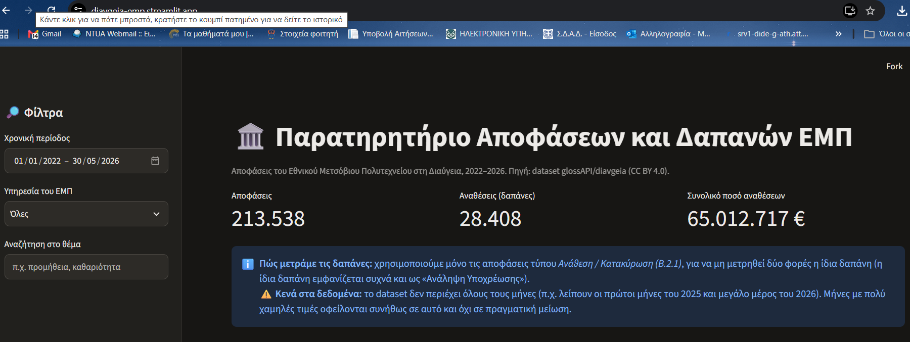
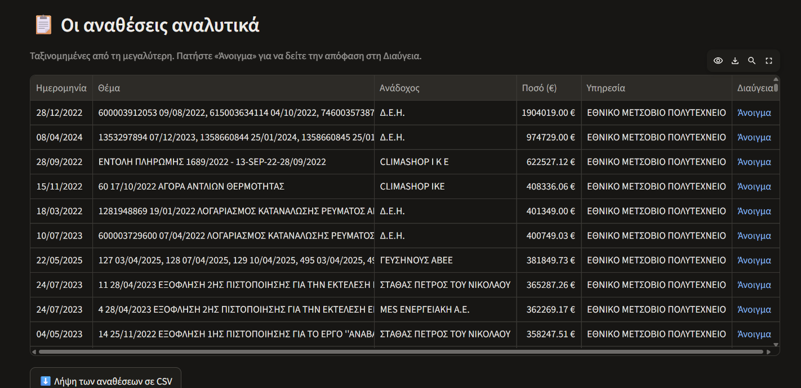
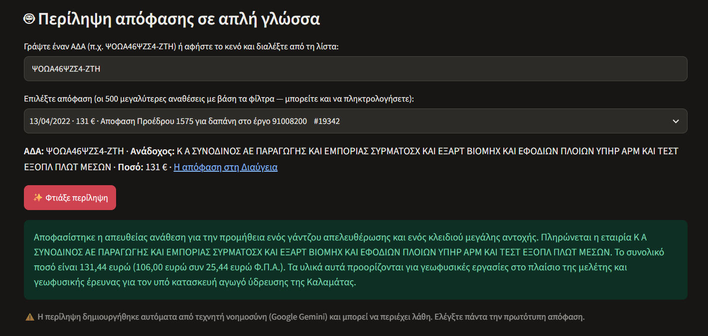

# Οδηγός χρήσης — Παρατηρητήριο Αποφάσεων και Δαπανών ΕΜΠ

Η εφαρμογή ανοίγει σε οποιονδήποτε browser, σε υπολογιστή ή κινητό, χωρίς εγγραφή:
👉 **https://diavgeia-emp.streamlit.app**

> Αν η σελίδα γράφει «This app has gone to sleep», πατήστε **«Yes, get this app back up!»** και περιμένετε
> 1–2 λεπτά. Η δωρεάν υπηρεσία «κοιμίζει» τις εφαρμογές που δεν χρησιμοποιήθηκαν για λίγες μέρες.

---

## 1. Η αρχική εικόνα

Στο πάνω μέρος βλέπετε τρία νούμερα για την περίοδο που έχετε επιλέξει:

- **Αποφάσεις:** όλες οι αποφάσεις του ΕΜΠ στη Διαύγεια (κάθε είδους).
- **Αναθέσεις (δαπάνες):** οι αποφάσεις με τις οποίες το ΕΜΠ αναθέτει μια αγορά ή υπηρεσία και πληρώνει.
- **Συνολικό ποσό αναθέσεων:** πόσα χρήματα αφορούν αυτές οι αναθέσεις.

Το μπλε πλαίσιο εξηγεί πώς μετράμε τις δαπάνες και προειδοποιεί ότι κάποιοι μήνες λείπουν από τα δεδομένα.

## 2. Τα φίλτρα (αριστερά)

Με τα φίλτρα αλλάζουν **όλα** τα νούμερα, τα γραφήματα και ο πίνακας της σελίδας.

| Φίλτρο | Τι κάνει | Παράδειγμα |
|---|---|---|
| **Χρονική περίοδος** | Δείχνει μόνο αποφάσεις ανάμεσα σε δύο ημερομηνίες | 01/01/2024 – 31/12/2024 |
| **Υπηρεσία του ΕΜΠ** | Δείχνει μόνο τις αποφάσεις μιας υπηρεσίας | Ειδικός Λογαριασμός Κονδυλίων Έρευνας |
| **Αναζήτηση στο θέμα** | Δείχνει όσες έχουν τη λέξη στο θέμα τους. Δεν μετράνε τόνοι και κεφαλαία | καθαριότητα, κλιματιστικά, ρεύμα |

Στο κινητό, τα φίλτρα ανοίγουν με το βελάκι **»** πάνω αριστερά.

## 3. Τα γραφήματα

- **Δαπάνες ανά μήνα:** πόσα χρήματα αναθέσεων έχει κάθε μήνας. Περάστε το ποντίκι πάνω από μια μπάρα για να δείτε το ακριβές ποσό.
- **Οι 10 μεγαλύτεροι ανάδοχοι:** οι εταιρείες ή τα πρόσωπα που πήραν τα περισσότερα χρήματα.
  Το κουτάκι **«Χωρίς φόρους και εισφορές»** κρύβει τις πληρωμές προς ΔΟΥ και ΕΦΚΑ, που δεν είναι προμηθευτές.
- **Αποφάσεις ανά τύπο:** τι είδους αποφάσεις βγάζει το ΕΜΠ (αναθέσεις, αναλήψεις υποχρέωσης, προσλήψεις κ.λπ.).

Σε κάθε γράφημα, πάνω δεξιά, υπάρχουν κουμπιά για μεγέθυνση και για λήψη του γραφήματος ως εικόνα.

## 4. Ο πίνακας των αναθέσεων

Εδώ είναι όλες οι αναθέσεις, από τη μεγαλύτερη στη μικρότερη.

- Πατήστε σε έναν **τίτλο στήλης** για να ταξινομήσετε, π.χ. κατά ημερομηνία.
- Πατήστε **«Άνοιγμα»** για να δείτε την πρωτότυπη απόφαση στη Διαύγεια.
- Πατήστε **«⬇️ Λήψη των αναθέσεων σε CSV»** για να πάρετε τον πίνακα σε αρχείο που ανοίγει στο Excel.

## 5. Περίληψη απόφασης σε απλή γλώσσα

Εδώ η τεχνητή νοημοσύνη (Google Gemini) «μεταφράζει» μια απόφαση σε απλά ελληνικά.

1. **Διαλέξτε απόφαση** από τη λίστα. Έχει τις 500 μεγαλύτερες αναθέσεις με βάση τα φίλτρα σας.
   Μπορείτε να γράψετε μέσα στη λίστα για να ψάξετε.
   *ή*
   **Γράψτε τον ΑΔΑ** μιας απόφασης στο κουτί (π.χ. `ΨΟΩΑ46ΨΖΣ4-ΖΤΗ`), αν ξέρετε ποια θέλετε.
2. Πατήστε **«✨ Φτιάξε περίληψη»**.
3. Περιμένετε 5–20 δευτερόλεπτα. Η περίληψη εμφανίζεται σε πράσινο πλαίσιο και λέει **τι** αποφασίστηκε,
   **ποιος** πληρώνεται, **πόσα** και **για ποιο σκοπό**.

⚠️ Η περίληψη γράφεται αυτόματα και μπορεί να έχει λάθη. Για κάτι σημαντικό, ελέγξτε πάντα την
απόφαση στη Διαύγεια (σύνδεσμος «Η απόφαση στη Διαύγεια»).

## 6. Συχνά προβλήματα

| Τι βλέπετε | Τι κάνετε |
|---|---|
| «Η υπηρεσία Gemini είναι προσωρινά φορτωμένη» | Περιμένετε 1–2 λεπτά και πατήστε ξανά «Φτιάξε περίληψη». |
| «Δεν βρέθηκε ανάθεση ή σύμβαση με κείμενο για αυτόν τον ΑΔΑ» | Ελέγξτε ότι γράψατε σωστά τον ΑΔΑ. Περιλήψεις υπάρχουν μόνο για αναθέσεις και συμβάσεις του ΕΜΠ, 2022–2026. |
| Τα νούμερα είναι 0 | Μάλλον τα φίλτρα δεν ταιριάζουν σε καμία απόφαση. Σβήστε τη λέξη αναζήτησης ή μεγαλώστε την περίοδο. |
| Ένας μήνας έχει πολύ μικρό ποσό | Συνήθως λείπουν αποφάσεις από τα δεδομένα εκείνου του μήνα (βλ. μπλε πλαίσιο). |
| Η εφαρμογή «κοιμάται» | Πατήστε «Yes, get this app back up!» και περιμένετε 1–2 λεπτά. |

## 7. Σχετικά

Στο τέλος της σελίδας, στο **«ℹ️ Σχετικά με την εφαρμογή και την αξιολόγησή της»**, θα βρείτε από πού είναι
τα δεδομένα και τα αποτελέσματα του ελέγχου ακρίβειας. Περισσότερα στο [README](README.md).
